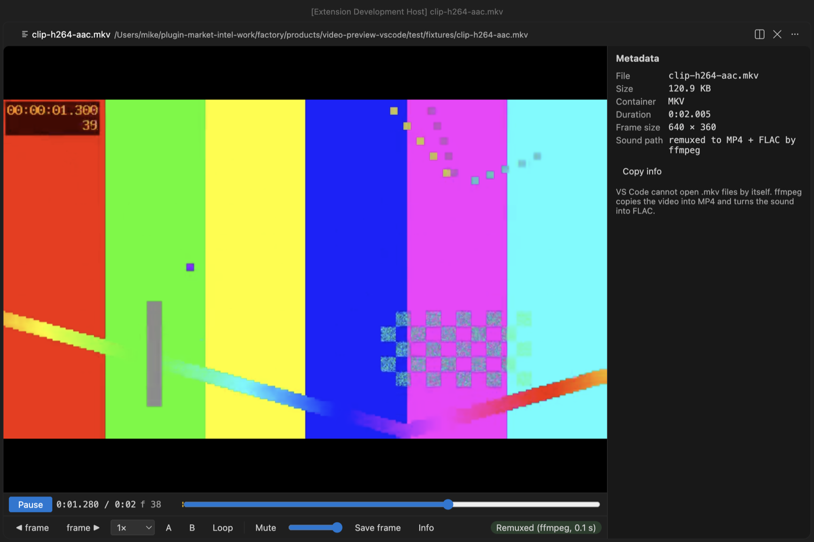
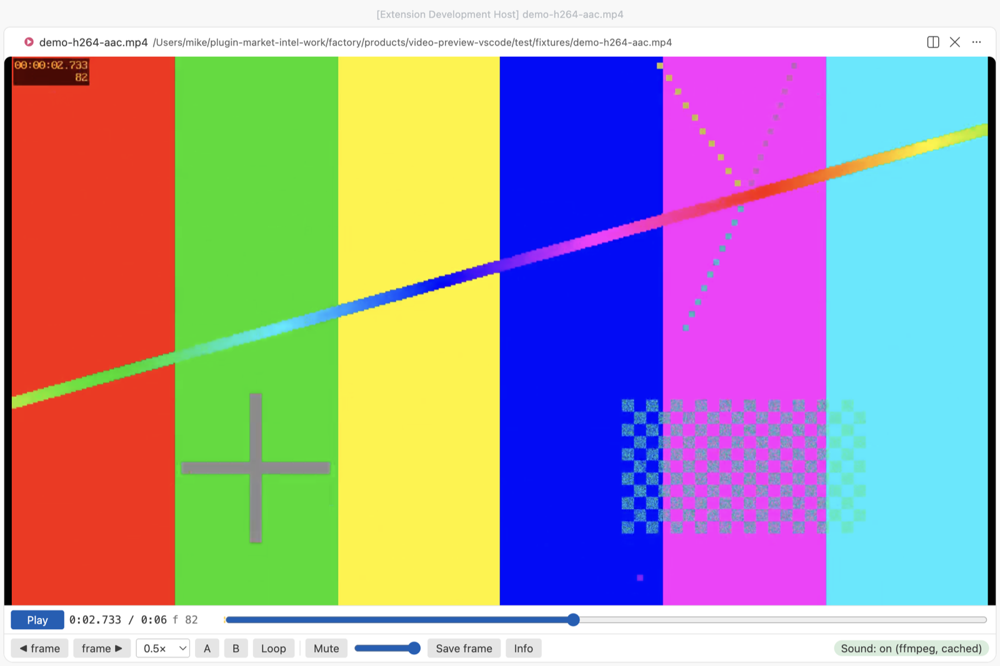
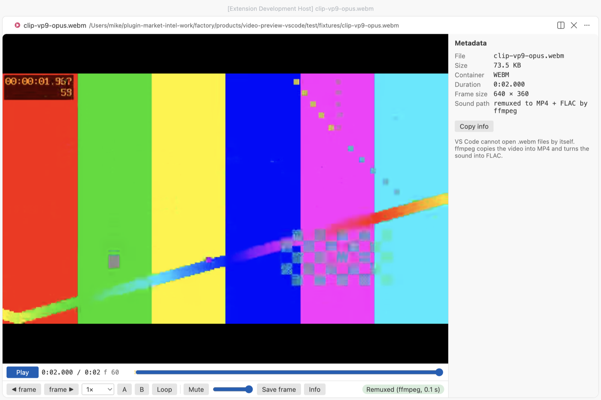

# MP4 Video Player & Video Preview with Sound

Click an `.mp4`, `.mov`, `.mkv` or `.webm` file and it plays in a video player inside VS Code with its sound, which VS Code's own player leaves out for AAC audio.

*Real output from VS Code 1.142 on macOS. `scripts/e2e-vscode.mjs` opened the 6-second sample from `scripts/make-samples.js` with this extension, clicked Play, set the loop with the A and B keys and took the window screenshot over the Chrome DevTools protocol. The webview measured the sound level at 0.12 RMS while it played. VS Code's own player gives 0 on the same file.*

- You hear the sound. VS Code can show H.264 video but has no AAC decoder, and most MP4 and MOV files use AAC. This extension decodes the sound to FLAC with a program you already have (afconvert, which comes with macOS, or your own ffmpeg) and keeps it in step with the picture. In our tests the drift stayed under 0.1 s.
- It's built for checking clips frame by frame. Step one frame at a time, play at 0.1× to 4×, loop between two points, and save the exact frame as a full-size PNG. The frame counter matches the frame number that ffmpeg burned into the test video.
- It opens files VS Code can't open at all. VS Code's player has no MKV or WebM support. With ffmpeg installed, the video stream is copied into MP4 without re-encoding (0.1 s for our samples) and plays with sound.

## Quick start

1. Install Video Preview with Sound. On Windows run `winget install ffmpeg`, on Linux `sudo apt install ffmpeg`. macOS needs nothing, though ffmpeg (`brew install ffmpeg`) is faster and adds MKV and WebM.
2. Click a video in the Explorer and press Space.

If VS Code asks which editor to use for `.mp4`, pick "Video Preview with Sound" (VS Code has its own simple preview too). Run "Video Preview: Get Started" from the Command Palette for a short tour.

## Why VS Code mutes your videos

VS Code's built-in Chromium ships with the H.264 video decoder but without AAC. We tested this on VS Code 1.142 (Electron 43, Chrome 150) before writing any player code. `canPlayType` and WebCodecs both say AAC is supported, but decoding fails, and the audio element reports 0 decoded bytes. MP3, FLAC and WAV sound do play. So the extension reads the codec from the file header and picks one of these paths.

| The file has | What happens | Helper |
|---|---|---|
| H.264, HEVC or VP9 video with MP3 or FLAC sound | VS Code plays it directly | none |
| AAC, AC-3, E-AC-3, Opus or ALAC sound in MP4, M4V or MOV | the sound is decoded to FLAC and plays next to the muted video | afconvert (macOS) or ffmpeg |
| MKV or WebM | video copied into MP4, sound converted to FLAC, one file | ffmpeg |
| no audio track | plays, and the chip says "No audio track" | none |

The FLAC file goes into the extension's own storage folder and is reused next time, so a file is only decoded once. The cache keeps the newest 2 GB by default. "Video Preview: Clear Sound Cache" empties it.

## Controls

| Key | Action |
|---|---|
| Space or K, or click the picture | Play or pause |
| `,` and `.` | One frame back or forward |
| Left and Right | 5 s back or forward (with Shift, 1 s) |
| `[` and `]` | Slower or faster, 0.1× to 4× |
| A, then B | Set the loop start and end. The loop turns on and shows on the seek bar |
| L | Loop on or off |
| M | Mute |
| S | Save the current frame as a PNG at the video's full size |
| I | Show or hide the metadata |

The metadata panel shows container brands, duration, codec, frame size, frame rate, frame count, bitrates, sample rate, channels and language, read by mp4box.js from the file header. "Copy info" puts it on the clipboard as plain text. Frame PNGs get a name like `clip-00m12s345-f370.png`, so you can tell later where they came from.

## Settings

| Setting | Default | What it does |
|---|---|---|
| `videoPreview.soundHelper` | `auto` | `auto` uses ffmpeg if it's found, else afconvert on macOS. `ffmpeg`, `afconvert` or `off` force one choice |
| `videoPreview.ffmpegPath` | empty | Full path to ffmpeg. Empty means search PATH, `/opt/homebrew/bin` and `/usr/local/bin` |
| `videoPreview.decodeSoundAutomatically` | `true` | Off means the helper waits for a click on "Turn on sound" |
| `videoPreview.maxDecodeSizeMB` | 4096 | Bigger files still play, without sound, and the chip says why |
| `videoPreview.cacheSizeMB` | 2048 | Disk space for decoded sound and remuxed files |
| `videoPreview.helperTimeoutSeconds` | 900 | The helper is stopped after this long |
| `videoPreview.askForRating` | true | Ask one time for a Marketplace rating, after 5 files and 2 days. Turn it off with `false` |
| `videoPreview.showSupportLinks` | true | Show the small Sponsor and More free viewers links under the player controls |

## Privacy and safety

The extension makes no network calls and has no telemetry. The webview runs under a strict Content Security Policy with no inline or remote scripts, and file names and metadata are only ever set as text. Nothing in a video file is run. The helper is started with an argument list and no shell, ffmpeg reads the input through `file:` so a crafted file name can't act as an option or protocol, and closing the tab stops it. In an untrusted workspace no helper starts until you click "Turn on sound". ffmpeg isn't bundled, so no GPL or LGPL code ships with this extension.

## Known limits

- Big files stream from disk and the picture starts at once, but the sound has to be decoded first. For a 1-hour AAC track that took 5.7 s with ffmpeg and 17.8 s with afconvert on an M-series Mac. The video plays muted until the chip says "Sound: on".
- FLAC is large. That 1-hour track became about 370 MB in the cache, so the 2 GB default holds roughly five hours of sound.
- The separate sound track is nudged when it drifts more than 0.04 s from the picture and moved back when it drifts more than 0.25 s. MKV and WebM stay tighter, because they play as one remuxed file.
- MKV and WebM with VP8 or Theora video can't be copied into MP4. You'll get the ffmpeg error message instead.
- HEVC needs hardware decoding, which macOS has. AV1 depends on your GPU.
- Remote and virtual workspaces play the video, but the helper only runs on local files.
- `.avi` isn't opened. VS Code can't read it and remuxing usually needs a re-encode.

## Support

Zovo extensions have no ads and no tracking, and sponsors pay for the time that goes into fixes and new viewers. You can sponsor the work on [GitHub Sponsors](https://github.com/sponsors/theluckystrike).

## More viewers by Zovo

- [PDF Viewer & PDF Reader with Dark Mode](https://marketplace.visualstudio.com/items?itemName=zovo.pdf-viewer-dark) reads PDFs with a real dark mode, search, an outline and thumbnails.
- [CSV Viewer, Excel Viewer (XLSX) & Parquet Viewer](https://marketplace.visualstudio.com/items?itemName=zovo.table-viewer-vscode) opens CSV, TSV, Excel and Parquet files as a sortable, filterable table.
- [Large JSON Viewer & JSON Tree](https://marketplace.visualstudio.com/items?itemName=zovo.zovo-json-tree-viewer) shows large JSON files as a searchable tree, copies JSONPath and turns arrays of objects into a table.
- [DOCX Viewer & Word Viewer with Dark Mode](https://marketplace.visualstudio.com/items?itemName=zovo.docx-viewer-vscode) previews Word and ODT files with dark mode, an outline and search.
- [PPTX Viewer & PowerPoint Viewer](https://marketplace.visualstudio.com/items?itemName=zovo.pptx-slide-viewer) shows PowerPoint slides, thumbnails and speaker notes.
- [JSONL Viewer & NDJSON Viewer (JSONL Table)](https://marketplace.visualstudio.com/items?itemName=zovo.zovo-jsonl-viewer) opens JSONL and NDJSON files as a table, as records or as a chat view.
- [SQLite Viewer & DB Viewer (Read-Only)](https://marketplace.visualstudio.com/items?itemName=zovo.sqlite-table-viewer) browses SQLite tables read-only and runs SELECT queries.
- [HDF5 & NetCDF Explorer (H5 Viewer)](https://marketplace.visualstudio.com/items?itemName=zovo.hdf5-netcdf-explorer) browses groups, attributes and values in HDF5 and NetCDF files and plots slices.
- [GGUF, Safetensors & NPY Viewer (NumPy Viewer)](https://marketplace.visualstudio.com/items?itemName=zovo.tensor-viewer) shows NPY, NPZ, Safetensors and GGUF tensors with stats and heatmaps.
- [DXF Viewer & CAD Viewer for 2D Drawings](https://marketplace.visualstudio.com/items?itemName=zovo.dxf-viewer) opens ASCII and binary DXF drawings with layers, measuring and PNG or SVG export.
- [AGENTS.md & CLAUDE.md Linter (Context Drift)](https://marketplace.visualstudio.com/items?itemName=zovo.context-drift) finds stale commands, paths and versions in AGENTS.md and CLAUDE.md files.
- [Agent Skills & Claude Skills (Skill Shelf)](https://marketplace.visualstudio.com/items?itemName=zovo.skill-shelf) lists, checks and toggles the Agent Skills that Claude Code, Codex and Cursor load.
- [Claude Code History & Codex History Viewer](https://marketplace.visualstudio.com/items?itemName=zovo.agent-session-viewer) browses and searches your local Claude Code and Codex sessions.
- [Claude Code Usage & Codex Usage Cost Meter](https://marketplace.visualstudio.com/items?itemName=zovo.ai-usage-meter) shows Claude Code and Codex tokens and estimated cost from your local session files.

Coming soon to the Marketplace, with the code on GitHub now.

- [Audio Preview & Loudness Meter](https://github.com/theluckystrike/audio-preview-vscode) plays audio files with a waveform, a spectrogram and LUFS loudness.
- [Graphviz Preview & DOT Viewer](https://github.com/theluckystrike/graphviz-preview-vscode) shows a live preview of DOT files and exports SVG or PNG.
- [TIFF Viewer (16-bit, Float, GeoTIFF)](https://github.com/theluckystrike/tiff-viewer-vscode) opens 16-bit, float, multi-page and GeoTIFF images.
- [Avro Viewer, Arrow Viewer & Feather Viewer](https://github.com/theluckystrike/arrow-avro-viewer-vscode) opens Avro, Arrow and Feather files as a paged table.
- [EML Viewer & MBOX Email Viewer](https://github.com/theluckystrike/eml-viewer-vscode) reads EML, EMLX and MBOX email files with remote images blocked.
- [3D Model Viewer (GLB, glTF, STL, OBJ, PLY)](https://github.com/theluckystrike/model-viewer-vscode) views GLB, glTF, STL, OBJ, PLY and 3MF models.
- [PKL Viewer & Pickle Viewer](https://github.com/theluckystrike/pickle-viewer-vscode) opens Python pickle files without Python and never runs their code.
- [DICOM Viewer & NIfTI Viewer for CT and MRI](https://github.com/theluckystrike/dicom-nifti-viewer-vscode) opens CT and MRI scans, DICOM folders and NIfTI volumes with window presets and three views.
- [ZIP Viewer & Archive Explorer (JAR, TAR, GZ)](https://github.com/theluckystrike/archive-explorer-vscode) browses ZIP, JAR, VSIX, TAR and GZ files, opens entries in tabs and extracts them safely.
- [GCode Viewer & 3D Print Preview](https://github.com/theluckystrike/gcode-viewer-vscode) shows GCode toolpaths in 3D layer by layer, with print time and filament use.
- [EPUB Reader & EPUB Viewer](https://github.com/theluckystrike/epub-reader-vscode) reads EPUB books with a table of contents, search and light, sepia or dark themes.
- [HAR Viewer & HTTP Archive Viewer](https://github.com/theluckystrike/har-viewer-vscode) opens HAR files from browser DevTools with a timing waterfall, filters and a redacted copy for sharing.
- [Font Viewer & Font Preview (TTF, OTF, WOFF)](https://github.com/theluckystrike/font-viewer-vscode) opens TTF, OTF, WOFF, WOFF2 and TTC fonts with a glyph grid, a type tester with variable axes and the license fields.
- [File Viewers Pack](https://github.com/theluckystrike/zovo-file-viewers) installs the PDF, table, Word, PowerPoint, HDF5 and tensor viewers in one step.

## License

MIT. mp4box.js is BSD-3-Clause, see `THIRD-PARTY-NOTICES.md`.
