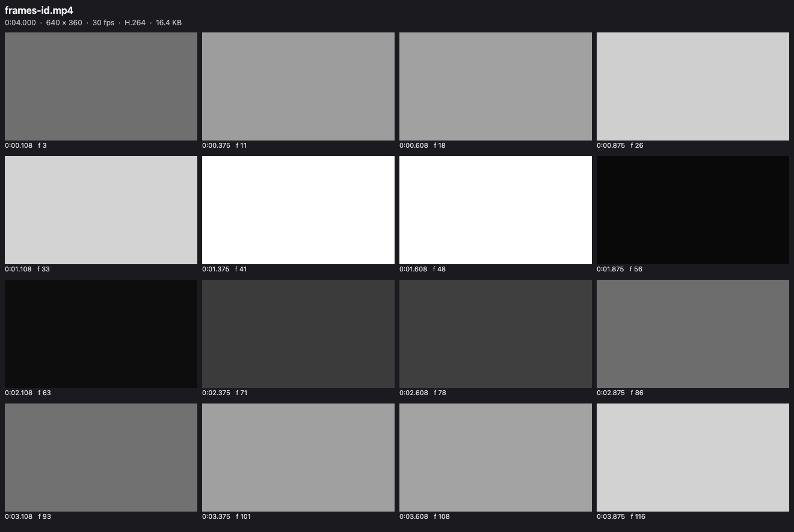

# MP4, MOV, MKV & WebM Viewer, Video Player & Preview with Sound

Click an `.mp4`, `.mov`, `.mkv`, `.webm` or `.avi` file and it plays in a video player inside VS Code with its sound, which VS Code's own player leaves out for AAC audio.

Version 0.2.5 plays AAC sound in MP4 and MOV with nothing to install, on Windows, Linux and macOS. A built-in decoder ships inside the extension. It also adds a picture-in-picture button (P).

Version 0.2.0 added three things. Videos VS Code can't decode, such as Apple ProRes, MPEG-4 Part 2 and AVI, are converted to H.264 with your ffmpeg and then play. Subtitles from an `.srt` or `.vtt` file next to the video show up by themselves. And each video opens where you stopped it last time.

*Real output from VS Code 1.142 on macOS. The four new screenshots above and below come from the 0.2.0 VSIX installed in a clean VS Code profile, with test clips made by ffmpeg. `scripts/e2e-vscode.mjs` opened the 6-second sample from `scripts/make-samples.js` with this extension, clicked Play, set the loop with the A and B keys and took the window screenshot over the Chrome DevTools protocol. The webview measured the sound level at 0.12 RMS while it played. VS Code's own player gives 0 on the same file.*

- You hear the sound, with no setup. VS Code can show H.264 video but has no AAC decoder, and most MP4 and MOV files use AAC. The extension carries its own decoder (Symphonia, compiled to WebAssembly, about 820 KB). It decodes AAC, ALAC, MP3 and PCM sound in a background thread and keeps the result in step with the picture. A 150-second AAC track took 0.2 s on an M-series Mac. For other sound, such as AC-3, E-AC-3, DTS or 5.1 AAC, it uses your ffmpeg or the afconvert that comes with macOS.
- Picture-in-picture. The PiP button (or P) floats the video over your other windows while the sound keeps playing.
- It's built for checking clips frame by frame. Step one frame at a time, play at 0.1× to 4×, loop between two points, and save the exact frame as a full-size PNG. The frame counter matches the frame number that ffmpeg burned into the test video.
- It converts what VS Code can't decode. A ProRes `.mov`, an MPEG-4 Part 2 `.mp4`, or an `.avi`, `.wmv`, `.flv`, `.mpg`, `.ogv` or `.m2ts` file is turned into H.264 with your ffmpeg and plays. A 3-second 1080p ProRes test clip took 0.4 s. The chip shows the progress, and the copy stays in the cache, so the next open is instant. If a video still won't show a picture, the player converts it once by itself instead of leaving a black box.
- Subtitles just work. `clip.srt`, `clip.vtt`, `clip.en.srt` or `clip.pt-BR.vtt` next to `clip.mp4` load as you open the video. Press C or use the CC menu to switch tracks, turn them off, or load any other `.srt` or `.vtt` file.
- It remembers where you stopped. Each video opens at the point you left it, with the same speed, and your volume carries over to the next video. A toast says "Resumed at 1:23", and Home goes back to the start.

- It opens MKV and WebM, which VS Code can't open at all. This needs ffmpeg on every system. The video stream is copied into MP4 without re-encoding (0.1 s for our samples) and plays with sound. MKV files with VP8, MPEG-4 Part 2 or MPEG-2 video are converted to H.264 instead.
- Pro, if you want it: save the A-B part as a GIF or an MP4 clip, save frames as numbered PNG files, or save a contact sheet of the whole video. Each Pro tool has 3 free tries. Zovo Pro is USD 19 once for every Zovo viewer.

## Quick start

1. Install Video Preview with Sound. MP4, MOV and M4V files with AAC sound play with no other install. For MKV, WebM, AVI and AC-3 sound, add ffmpeg: `winget install ffmpeg` on Windows, `sudo apt install ffmpeg` on Linux, `brew install ffmpeg` on macOS.
2. Click a video in the Explorer and press Space.

If VS Code asks which editor to use for `.mp4`, pick "Video Preview with Sound" (VS Code has its own simple preview too). Run "Video Preview: Get Started" from the Command Palette for a short tour.

## Why VS Code mutes your videos

VS Code's built-in Chromium ships with the H.264 video decoder but without AAC. We tested this on VS Code 1.142 (Electron 43, Chrome 150) before writing any player code. `canPlayType` and WebCodecs both say AAC is supported, but decoding fails, and the audio element reports 0 decoded bytes. MP3, FLAC and WAV sound do play. VS Code 1.142 also has no Matroska demuxer: an `.mkv` or `.webm` in its video element fails with "FFmpegDemuxer: open context failed", even with VP9 and Opus inside. So the extension reads the codec from the file header and picks one of these paths.

| The file has | What happens | Helper |
|---|---|---|
| H.264, HEVC or VP9 video with MP3 or FLAC sound | VS Code plays it directly | none |
| AAC (mono or stereo), ALAC, PCM or MP3 sound in MP4, M4V or MOV | the sound is decoded and plays next to the muted video | none (built-in decoder), or ffmpeg or afconvert if found |
| AC-3, E-AC-3, DTS, Opus or 5.1 AAC sound in MP4, M4V or MOV | the sound is decoded to FLAC and plays next to the muted video | afconvert (macOS) or ffmpeg |
| MKV or WebM | video copied into MP4, sound converted to FLAC, one file. VP8, Theora, MPEG-4 Part 2 or MPEG-2 video is converted to H.264 | ffmpeg |
| no audio track | plays, and the chip says "No audio track" | none |
| ProRes, MPEG-4 Part 2, DNxHD or other video VS Code can't decode, and `.avi`, `.wmv`, `.flv`, `.mpg`, `.mpeg`, `.ogv`, `.m2ts` | converted to H.264 (libx264, or VideoToolbox or Media Foundation if your ffmpeg has no libx264), sound to FLAC | ffmpeg |

The decoded sound (FLAC from ffmpeg or afconvert, WAV from the built-in decoder) goes into the extension's own storage folder and is reused next time, so a file is only decoded once. The cache keeps the newest 2 GB by default. "Video Preview: Clear Sound Cache" empties it.

## Controls

| Key | Action |
|---|---|
| Space or K, or click the picture | Play or pause |
| `,` and `.` | One frame back or forward |
| Left and Right | 5 s back or forward (with Shift, 1 s) |
| `[` and `]` | Slower or faster, 0.1× to 4× |
| A, then B | Set the loop start and end. The loop turns on and shows on the seek bar |
| L | Loop on or off |
| M | Mute |
| S | Save the current frame as a PNG at the video's full size |
| I | Show or hide the metadata |
| C | Subtitles on or off |
| Home | Back to the start |

The metadata panel shows container brands, duration, codec, frame size, frame rate, frame count, bitrates, sample rate, channels and language, read by mp4box.js from the file header. "Copy info" puts it on the clipboard as plain text. Frame PNGs get a name like `clip-00m12s345-f370.png`, so you can tell later where they came from.

## Settings

| Setting | Default | What it does |
|---|---|---|
| `videoPreview.soundHelper` | `auto` | `auto` uses ffmpeg if it's found, else afconvert on macOS, else the built-in decoder. `ffmpeg`, `afconvert`, `builtin` or `off` force one choice |
| `videoPreview.ffmpegPath` | empty | Full path to ffmpeg. Empty means search PATH, `/opt/homebrew/bin` and `/usr/local/bin` |
| `videoPreview.decodeSoundAutomatically` | `true` | Off means the helper waits for a click on "Turn on sound" |
| `videoPreview.maxDecodeSizeMB` | 4096 | Bigger files still play, without sound, and the chip says why |
| `videoPreview.cacheSizeMB` | 2048 | Disk space for decoded sound and remuxed files |
| `videoPreview.helperTimeoutSeconds` | 900 | The helper is stopped after this long |
| `videoPreview.convertUnsupportedVideo` | `true` | Convert video VS Code can't decode to H.264 with ffmpeg by itself. Off means a Convert button |
| `videoPreview.subtitles.autoLoad` | `true` | Load `.srt` and `.vtt` files with the same name as the video |
| `videoPreview.rememberPosition` | `true` | Open each video where you stopped it, and keep the volume |
| `videoPreview.autoplay` | `false` | Start playing as soon as a video opens |
| `videoPreview.askForRating` | true | Ask for a rating after videos opened without an error in 2 sessions at least 4 hours apart. "Later" asks one more time after 7 days, "No thanks" never again. It never asks after an error. In Cursor, Windsurf and VSCodium "Rate it" opens Open VSX. Turn it off with `false`. |
| `videoPreview.showSupportLinks` | true | Show the small Sponsor and More free viewers links under the player controls |
| `videoPreview.showProFeatures` | true | Off: hide the Pro tools (Clip, Frames, Sheet), their PRO badges and the Zovo Pro commands, so you see only the free player. With a Zovo Pro license they always show. |

## Pro tools for clips, frames and contact sheets

Everything above is free and stays free. Three tools for people who share clips or work with frames are part of Zovo Pro. Each one has 3 free tries on your computer, and a try is used only when a file is saved: a cancelled dialog or a stopped export costs nothing. All three work on the A-B part when you set A and B, or on the whole video.

### Clip export

Press Clip and pick a GIF (480 px at 10 fps, 640 px at 15 fps, or up to 960 px at 15 fps, at most 60 seconds) for a pull request, an issue or docs. The GIF is made inside the player, with no other tool. Or pick an MP4 cut by your ffmpeg: "exact" re-encodes to H.264 and AAC and starts on the A frame, "fast copy" keeps the original streams and starts at the keyframe before A.

### Frame export

Press Frames and pick every frame, every 5th or 10th frame, one frame per second, or 10 evenly spaced frames, then a folder. Each frame is saved as a full-size PNG named like `clip-00m12s345-f370.png`, up to 1,000 per export, for a dataset, a bug report or a frame-by-frame review.

### Contact sheet

Press Sheet for one PNG with 16, 30 or 48 frames in a grid, each with its time and frame number, under a header with the file name, length, frame size, codecs and file size.

Esc stops an export. The player goes back to where you were.

### Getting Pro

Zovo Pro is USD 19 once, on GitHub Sponsors (the ["$19 one time" tier](https://github.com/sponsors/theluckystrike/sponsorships?tier_id=679878)) or by PayPal, and it unlocks the Pro features in every Zovo VS Code viewer: this one, [Hex Viewer](https://marketplace.visualstudio.com/items?itemName=zovo.zovo-hex-viewer) and [DOCX Viewer](https://marketplace.visualstudio.com/items?itemName=zovo.docx-viewer-vscode) today, and the Pro features other Zovo viewers get later. See [what Zovo Pro includes](https://theluckystrike.github.io/zovo-plugin-factory/pro.html).

- "Get Zovo Pro" (the command "Video Preview: Get Zovo Pro") opens the Zovo Pro tier on GitHub Sponsors in your browser.
- Then run "Video Preview: Unlock Zovo Pro with GitHub Sponsors". VS Code asks you to sign in with GitHub, and the player asks GitHub one question: has this account bought the Zovo Pro tier? If you bought it before, or you have a monthly sponsorship of USD 10 or more that is still running, this is all you need. The "$15 one time" and "$5 a month" tiers on the same page are for Obsidian plugins and do not include Zovo Pro.
- No GitHub account? Send USD 19 to [paypal.com/paypalme/najzzz/19](https://www.paypal.com/paypalme/najzzz/19) with "Zovo Pro" in the note, and you get a license key by email within a day.
- If you got a license key (it starts with ZOVO1.), paste it with "Video Preview: Enter Zovo Pro License Key". The key is checked on your computer and kept in VS Code's secret storage.
- "Video Preview: Remove Zovo Pro from This Editor" removes it.

Nothing about Pro shows up on its own: there is no popup when a video opens, no counter and no reminder. A Pro tool explains itself only when you click it after its free tries. `videoPreview.showProFeatures: false` hides the Pro tools.

## Privacy and safety

The extension has no telemetry and makes no network calls, except one call to GitHub when you choose "Unlock Zovo Pro with GitHub Sponsors" (a monthly sponsor gets one silent recheck every 30 days). A license key is checked on your computer. "Get Zovo Pro" opens a page in your browser. The video is never written; the extension writes only the files you save (Save frame and, with Pro, the clip, the frames and the contact sheet) and its sound cache. The webview runs under a strict Content Security Policy with no inline or remote scripts, and file names and metadata are only ever set as text. Nothing in a video file is run. The helper is started with an argument list and no shell, ffmpeg reads the input through `file:` so a crafted file name can't act as an option or protocol, and closing the tab stops it. In an untrusted workspace no helper starts until you click "Turn on sound". The built-in decoder still gives AAC sound there, because it starts no program: it is WebAssembly with no file or network access of its own, run in a worker thread that reads the one file in pieces. ffmpeg isn't bundled, so no GPL or LGPL code ships with this extension. The built-in decoder is Symphonia (MPL-2.0). Its source is in `wasm/` in the repository.

## Known limits

- Big files stream from disk and the picture starts at once, but the sound has to be decoded first. For a 1-hour AAC track that took 5.7 s with ffmpeg and 17.8 s with afconvert on an M-series Mac. The video plays muted until the chip says "Sound: on".
- FLAC is large. That 1-hour track became about 370 MB in the cache, so the 2 GB default holds roughly five hours of sound. The built-in decoder writes WAV, which is about twice that (11.5 MB a minute at 48 kHz stereo), so the cache holds about 3 hours of it.
- The built-in decoder plays HE-AAC from its AAC-LC core, at half the sample rate, so it lacks the top octave. Install ffmpeg for full HE-AAC, 5.1 AAC, AC-3 and DTS.
- Picture-in-picture closes when you switch to another editor tab, because VS Code unloads hidden players.
- The separate sound track is nudged when it drifts more than 0.02 s from the picture and moved back when it drifts more than 0.25 s. MKV and WebM stay tighter, because they play as one remuxed file.
- MKV and WebM with VP8, Theora, MPEG-4 Part 2 or MPEG-2 video can't play as a copy, so they are converted to H.264. On a long file that takes a while, like any conversion.
- Without ffmpeg, MKV and WebM don't open. The player says "Install ffmpeg to open this file" and offers Settings and Open in default app.
- HEVC needs hardware decoding, which macOS has. AV1 depends on your GPU.
- Remote and virtual workspaces play the video, but the helper only runs on local files.
- Converting needs your own ffmpeg; macOS afconvert can't convert video. Without ffmpeg the player says so and offers "Settings" and "Open in default app". Real footage converts slower than our test clip, and a long ProRes file can take minutes. The converted copy counts toward `videoPreview.cacheSizeMB`, and `maxDecodeSizeMB` and `helperTimeoutSeconds` apply to it too.
- Without libx264, ffmpeg falls back to VideoToolbox on macOS or Media Foundation on Windows at a fixed 8 Mb/s. On Linux use an ffmpeg with libx264.

- `.ts` and `.mts` files are never claimed, because those names are TypeScript files.
- Subtitles come only from `.srt` and `.vtt` files, as plain text at the bottom of the picture: no styling or positions, at most 5 MB and 20,000 cues per file and 20 files per video. Subtitles inside the video file are not read.
- Positions are kept on this computer for the 200 most recent videos. There is no resume in the first or last 5 seconds.
- The Pro tools grab each frame by seeking the player, so a long export takes a while: in our test, a 640 px GIF from a 720p H.264 video got about 14 frames a second on an M-series Mac, and full-size PNG frames are slower. GIFs have 256 colours per frame, so gradients show some banding; use MP4 for smooth footage.
- MP4 clips need your own ffmpeg and a file on this computer. GIFs, frames and contact sheets work without ffmpeg.

## Support Zovo

Zovo extensions are free, with no ads and no tracking. They are made by [theluckystrike](https://github.com/theluckystrike) on GitHub. If this one saves you time, you can support the work:

- [Sponsor on GitHub](https://github.com/sponsors/theluckystrike)
- [PayPal](https://www.paypal.com/paypalme/najzzz)
- [Follow theluckystrike on GitHub](https://github.com/theluckystrike)

### Need your format supported?

Open a [format request](https://github.com/theluckystrike/video-preview-vscode/issues/new?template=format-request.yml) with a sample file, and I reply there whether it can be done. For USD 299 once, through [this GitHub Sponsors tier](https://github.com/sponsors/theluckystrike/sponsorships?tier_id=679995), I add your file format or a missing feature to this extension, with tests, within 7 days.

## More tools by Zovo

- [Audio Player & WAV Player, Music & Wave Viewer (MP3, FLAC)](https://marketplace.visualstudio.com/items?itemName=zovo.audio-preview-vscode) plays audio files with a waveform, a spectrogram and LUFS loudness.
- [STL Viewer, OBJ Viewer, GLB & glTF Viewer](https://marketplace.visualstudio.com/items?itemName=zovo.3d-model-viewer) views GLB, glTF, STL, OBJ, PLY and 3MF models.
- [Font Viewer, TTF Viewer, OTF & WOFF Viewer, Font Preview](https://marketplace.visualstudio.com/items?itemName=zovo.font-viewer-vscode) opens TTF, OTF, WOFF, WOFF2 and TTC fonts with a glyph grid, a type tester with variable axes and the license fields.
- [PDF Viewer & Reader to Read and View PDF in Dark Mode](https://marketplace.visualstudio.com/items?itemName=zovo.pdf-viewer-dark) reads PDFs with a real dark mode, search, an outline and thumbnails.
- [XLSX Viewer & CSV Preview for Excel, XLS & Parquet](https://marketplace.visualstudio.com/items?itemName=zovo.table-viewer-vscode) opens CSV, TSV, Excel and Parquet files as a sortable, filterable table.

See [all Zovo extensions on the Marketplace](https://marketplace.visualstudio.com/publishers/zovo).

## License

MIT. mp4box.js is BSD-3-Clause, see `THIRD-PARTY-NOTICES.md`.
