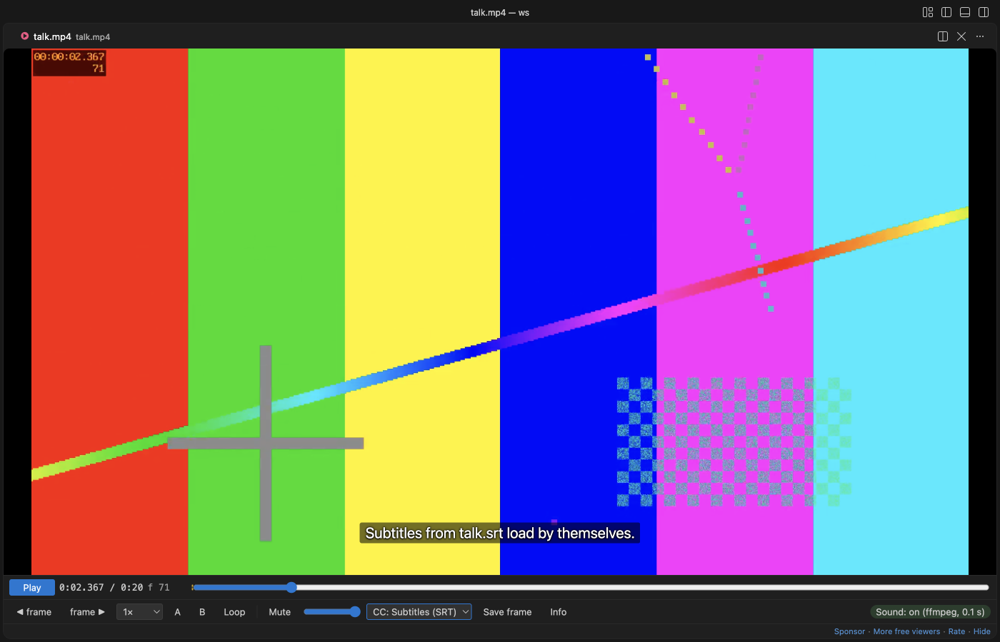
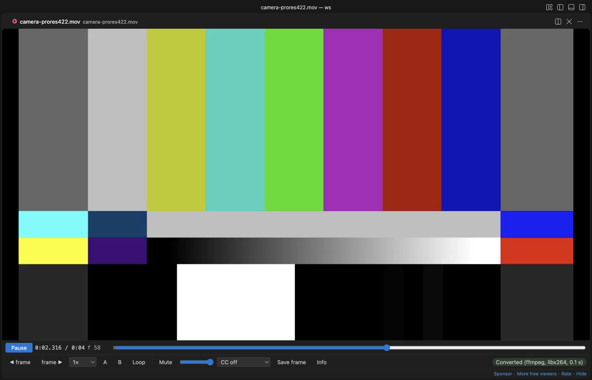
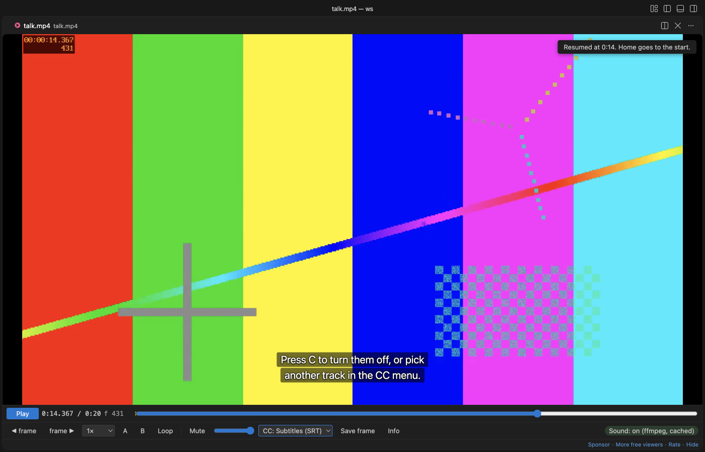
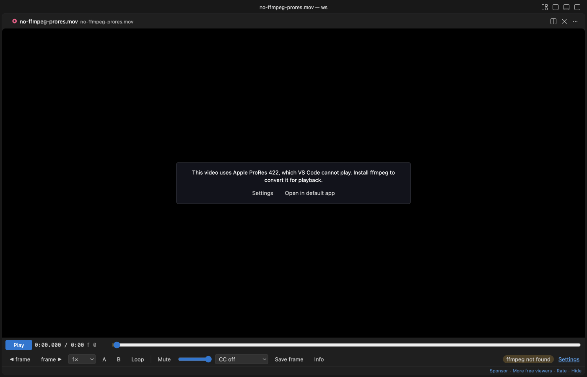

# MP4 & MOV Viewer, Video Player with Sound

Click an `.mp4`, `.mov`, `.mkv`, `.webm` or `.avi` file and it plays in a video player inside VS Code with its sound, which VS Code's own player leaves out for AAC audio.

Version 0.2.0 adds three things. Videos VS Code can't decode, such as Apple ProRes, MPEG-4 Part 2 and AVI, are converted to H.264 with your ffmpeg and then play. Subtitles from an `.srt` or `.vtt` file next to the video show up by themselves. And each video opens where you stopped it last time.

*Real output from VS Code 1.142 on macOS. The four new screenshots above and below come from the 0.2.0 VSIX installed in a clean VS Code profile, with test clips made by ffmpeg. `scripts/e2e-vscode.mjs` opened the 6-second sample from `scripts/make-samples.js` with this extension, clicked Play, set the loop with the A and B keys and took the window screenshot over the Chrome DevTools protocol. The webview measured the sound level at 0.12 RMS while it played. VS Code's own player gives 0 on the same file.*

- You hear the sound. VS Code can show H.264 video but has no AAC decoder, and most MP4 and MOV files use AAC. This extension decodes the sound to FLAC with a program you already have (afconvert, which comes with macOS, or your own ffmpeg) and keeps it in step with the picture. In our tests the drift stayed under 0.1 s.
- It's built for checking clips frame by frame. Step one frame at a time, play at 0.1× to 4×, loop between two points, and save the exact frame as a full-size PNG. The frame counter matches the frame number that ffmpeg burned into the test video.
- It converts what VS Code can't decode. A ProRes `.mov`, an MPEG-4 Part 2 `.mp4`, or an `.avi`, `.wmv`, `.flv`, `.mpg`, `.ogv` or `.m2ts` file is turned into H.264 with your ffmpeg and plays. A 3-second 1080p ProRes test clip took 0.4 s. The chip shows the progress, and the copy stays in the cache, so the next open is instant. If a video still won't show a picture, the player converts it once by itself instead of leaving a black box.
- Subtitles just work. `clip.srt`, `clip.vtt`, `clip.en.srt` or `clip.pt-BR.vtt` next to `clip.mp4` load as you open the video. Press C or use the CC menu to switch tracks, turn them off, or load any other `.srt` or `.vtt` file.
- It remembers where you stopped. Each video opens at the point you left it, with the same speed, and your volume carries over to the next video. A toast says "Resumed at 1:23", and Home goes back to the start.

- It opens files VS Code can't open at all. VS Code's player has no MKV or WebM support. With ffmpeg installed, the video stream is copied into MP4 without re-encoding (0.1 s for our samples) and plays with sound.

## Quick start

1. Install Video Preview with Sound. On Windows run `winget install ffmpeg`, on Linux `sudo apt install ffmpeg`. macOS needs nothing, though ffmpeg (`brew install ffmpeg`) is faster and adds MKV and WebM.
2. Click a video in the Explorer and press Space.

If VS Code asks which editor to use for `.mp4`, pick "Video Preview with Sound" (VS Code has its own simple preview too). Run "Video Preview: Get Started" from the Command Palette for a short tour.

## Why VS Code mutes your videos

VS Code's built-in Chromium ships with the H.264 video decoder but without AAC. We tested this on VS Code 1.142 (Electron 43, Chrome 150) before writing any player code. `canPlayType` and WebCodecs both say AAC is supported, but decoding fails, and the audio element reports 0 decoded bytes. MP3, FLAC and WAV sound do play. So the extension reads the codec from the file header and picks one of these paths.

| The file has | What happens | Helper |
|---|---|---|
| H.264, HEVC or VP9 video with MP3 or FLAC sound | VS Code plays it directly | none |
| AAC, AC-3, E-AC-3, Opus or ALAC sound in MP4, M4V or MOV | the sound is decoded to FLAC and plays next to the muted video | afconvert (macOS) or ffmpeg |
| MKV or WebM | video copied into MP4, sound converted to FLAC, one file | ffmpeg |
| no audio track | plays, and the chip says "No audio track" | none |
| ProRes, MPEG-4 Part 2, DNxHD or other video VS Code can't decode, and `.avi`, `.wmv`, `.flv`, `.mpg`, `.mpeg`, `.ogv`, `.m2ts` | converted to H.264 (libx264, or VideoToolbox or Media Foundation if your ffmpeg has no libx264), sound to FLAC | ffmpeg |

The FLAC file goes into the extension's own storage folder and is reused next time, so a file is only decoded once. The cache keeps the newest 2 GB by default. "Video Preview: Clear Sound Cache" empties it.

## Controls

| Key | Action |
|---|---|
| Space or K, or click the picture | Play or pause |
| `,` and `.` | One frame back or forward |
| Left and Right | 5 s back or forward (with Shift, 1 s) |
| `[` and `]` | Slower or faster, 0.1× to 4× |
| A, then B | Set the loop start and end. The loop turns on and shows on the seek bar |
| L | Loop on or off |
| M | Mute |
| S | Save the current frame as a PNG at the video's full size |
| I | Show or hide the metadata |
| C | Subtitles on or off |
| Home | Back to the start |

The metadata panel shows container brands, duration, codec, frame size, frame rate, frame count, bitrates, sample rate, channels and language, read by mp4box.js from the file header. "Copy info" puts it on the clipboard as plain text. Frame PNGs get a name like `clip-00m12s345-f370.png`, so you can tell later where they came from.

## Settings

| Setting | Default | What it does |
|---|---|---|
| `videoPreview.soundHelper` | `auto` | `auto` uses ffmpeg if it's found, else afconvert on macOS. `ffmpeg`, `afconvert` or `off` force one choice |
| `videoPreview.ffmpegPath` | empty | Full path to ffmpeg. Empty means search PATH, `/opt/homebrew/bin` and `/usr/local/bin` |
| `videoPreview.decodeSoundAutomatically` | `true` | Off means the helper waits for a click on "Turn on sound" |
| `videoPreview.maxDecodeSizeMB` | 4096 | Bigger files still play, without sound, and the chip says why |
| `videoPreview.cacheSizeMB` | 2048 | Disk space for decoded sound and remuxed files |
| `videoPreview.helperTimeoutSeconds` | 900 | The helper is stopped after this long |
| `videoPreview.convertUnsupportedVideo` | `true` | Convert video VS Code can't decode to H.264 with ffmpeg by itself. Off means a Convert button |
| `videoPreview.subtitles.autoLoad` | `true` | Load `.srt` and `.vtt` files with the same name as the video |
| `videoPreview.rememberPosition` | `true` | Open each video where you stopped it, and keep the volume |
| `videoPreview.autoplay` | `false` | Start playing as soon as a video opens |
| `videoPreview.askForRating` | true | Ask one time for a Marketplace rating, after 5 files and 2 days. Turn it off with `false` |
| `videoPreview.showSupportLinks` | true | Show the small Sponsor and More free viewers links under the player controls |

## Privacy and safety

The extension makes no network calls and has no telemetry. The webview runs under a strict Content Security Policy with no inline or remote scripts, and file names and metadata are only ever set as text. Nothing in a video file is run. The helper is started with an argument list and no shell, ffmpeg reads the input through `file:` so a crafted file name can't act as an option or protocol, and closing the tab stops it. In an untrusted workspace no helper starts until you click "Turn on sound". ffmpeg isn't bundled, so no GPL or LGPL code ships with this extension.

## Known limits

- Big files stream from disk and the picture starts at once, but the sound has to be decoded first. For a 1-hour AAC track that took 5.7 s with ffmpeg and 17.8 s with afconvert on an M-series Mac. The video plays muted until the chip says "Sound: on".
- FLAC is large. That 1-hour track became about 370 MB in the cache, so the 2 GB default holds roughly five hours of sound.
- The separate sound track is nudged when it drifts more than 0.04 s from the picture and moved back when it drifts more than 0.25 s. MKV and WebM stay tighter, because they play as one remuxed file.
- MKV and WebM with VP8 or Theora video can't be copied into MP4. You'll get the ffmpeg error message instead.
- HEVC needs hardware decoding, which macOS has. AV1 depends on your GPU.
- Remote and virtual workspaces play the video, but the helper only runs on local files.
- Converting needs your own ffmpeg; macOS afconvert can't convert video. Without ffmpeg the player says so and offers "Settings" and "Open in default app". Real footage converts slower than our test clip, and a long ProRes file can take minutes. The converted copy counts toward `videoPreview.cacheSizeMB`, and `maxDecodeSizeMB` and `helperTimeoutSeconds` apply to it too.
- Without libx264, ffmpeg falls back to VideoToolbox on macOS or Media Foundation on Windows at a fixed 8 Mb/s. On Linux use an ffmpeg with libx264.

- `.ts` and `.mts` files are never claimed, because those names are TypeScript files.
- Subtitles come only from `.srt` and `.vtt` files, as plain text at the bottom of the picture: no styling or positions, at most 5 MB and 20,000 cues per file and 20 files per video. Subtitles inside the video file are not read.
- Positions are kept on this computer for the 200 most recent videos. There is no resume in the first or last 5 seconds.

## Support Zovo

Zovo extensions are free, with no ads and no tracking. They are made by [theluckystrike](https://github.com/theluckystrike) on GitHub. If this one saves you time, you can support the work:

- [Sponsor on GitHub](https://github.com/sponsors/theluckystrike)
- [Follow theluckystrike on GitHub](https://github.com/theluckystrike)

## More tools by Zovo

- [3D Model Viewer (GLB, glTF, STL, OBJ, PLY)](https://marketplace.visualstudio.com/items?itemName=zovo.3d-model-viewer) views GLB, glTF, STL, OBJ, PLY and 3MF models.
- [PDF Viewer & PDF Reader with Dark Mode](https://marketplace.visualstudio.com/items?itemName=zovo.pdf-viewer-dark) reads PDFs with a real dark mode, search, an outline and thumbnails.
- [CSV Viewer, Excel Viewer (XLSX) & Parquet Viewer](https://marketplace.visualstudio.com/items?itemName=zovo.table-viewer-vscode) opens CSV, TSV, Excel and Parquet files as a sortable, filterable table.
- [Large JSON Viewer & JSON Tree](https://marketplace.visualstudio.com/items?itemName=zovo.zovo-json-tree-viewer) shows large JSON files as a searchable tree, copies JSONPath and turns arrays of objects into a table.

See [all Zovo extensions on the Marketplace](https://marketplace.visualstudio.com/publishers/zovo).

## License

MIT. mp4box.js is BSD-3-Clause, see `THIRD-PARTY-NOTICES.md`.
